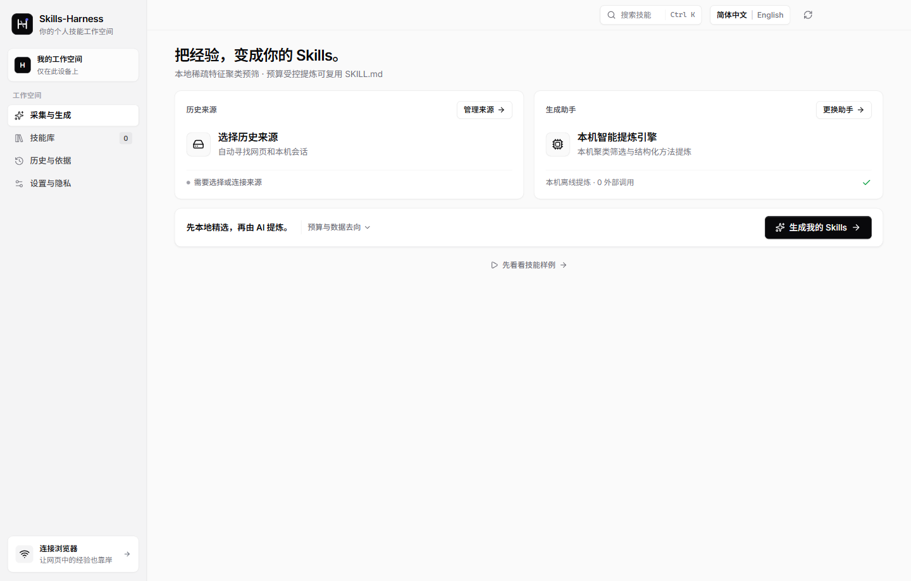

> **欢迎大家在我的基础上进行二次修改改进，欢迎批评指正。**  
> **Welcome to modify, improve, and build upon this work — critiques, issues, and pull requests are warmly welcomed!**

# Skills-Harness (`skills-harness`) — English Guide

**A local-first, three-channel conversational log compiler that decouples noisy multi-platform AI chat histories (across 22 ecosystems) into an encrypted Local Privacy Vault, executable Open-Source Agent Harness rules (`ECC`/Claude Code `hooks.json` & `Codex CLI` Starlark `.rules`), and verifiable `SKILL.md` playbooks.**

[](https://github.com/WYH302/skills-harness/actions/workflows/ci.yml)
[](https://github.com/WYH302/skills-harness/releases/latest)
[](LICENSE)
[](https://github.com/WYH302/skills-harness/releases/latest)
[](tests/)

[🚀 Direct Download (v0.1.14)](https://github.com/WYH302/skills-harness/releases/latest) · [Bilingual README (中文 + EN)](README.md) · [Installation](docs/INSTALL.md) · [Compatibility](docs/COMPATIBILITY.md) · [Privacy](docs/PRIVACY.md)



### 📥 Direct Downloads

| Version | Asset | Description |
| :--- | :--- | :--- |
| **Windows Installer (Recommended)** | [**`skills-harness-Setup-0.1.14-x64.exe`**](https://github.com/WYH302/skills-harness/releases/download/v0.1.14/skills-harness-Setup-0.1.14-x64.exe) | Bundles runtime, installs without admin rights, adds desktop & start menu shortcuts |
| **Windows Portable** | [**`skills-harness-0.1.14-Windows-x64.exe`**](https://github.com/WYH302/skills-harness/releases/download/v0.1.14/skills-harness-0.1.14-Windows-x64.exe) | Single executable, zero residue, runs directly from anywhere |

## Overview

**Skills-Harness** is a modest, local-first desktop workbench and three-channel log compiler built with Electron, React, TypeScript, and Node SQLite. Instead of flattening raw coding transcripts into one prompt store, it separates them locally on CPU into three orthogonal outputs:

1. **Channel 1 — Local Privacy Vault (`src/core/privacy-vault.ts`)**: Detects 10 bilingual PII and credential classes (API keys, PEM blocks, database URIs, JWTs, emails, phone numbers, checksum-verified IDs/SSNs, Luhn-verified bank cards, residential addresses, personal disclosures) with benign-code lookalike exemptions, encrypts them locally via **AES-256-GCM**, and exposes only typed placeholders `[VAULT:CATEGORY_NN]` downstream.
2. **Zero-Inference CPU Screening (`Pure Monotone CELF CTSS`, `src/core/selection.ts`)**: Screens multi-million-token logs strictly on CPU (`0 MiB VRAM`) via asymmetric submodular optimization ($\sqrt{z}$ action coverage + $\log(1+z)$ repair survival), cutting downstream distillation tokens by **97.0%–97.8%**.
3. **Channel 2 — Open-Source Agent Harness Compiler (`src/core/harness-compiler.ts`)**: Compiles recurring prohibitions, tool substitutions, prerequisites, recurring verifiers, and `PostOutput` invariants directly into schema-valid **`ECC`/Claude Code `hooks.json`** (exit-code-2 guard runner) and **OpenAI `Codex CLI` Starlark `.rules`**.
4. **Channel 3 — Verifiable `SKILL.md` Playbooks (`src/core/skills.ts` & `anchor-matcher.ts`)**: Combines a Hybrid Anchor Gate (symbolic literal/polarity pre-gate + quantized CPU ONNX encoder), Kahn topological sorting, blind-metadata repository-scope isolation, poisoned-skill firewall, and staleness reconciliation to emit 100% verbatim-anchored `SKILL.md` playbooks.

## Design Reflections & Lessons Learned

Building this tool over tens of millions of tokens of real coding logs taught us three practical lessons (and exposed clear edges where community help is welcome):

- **Flat summarization conflates three incompatible boundaries**: Feeding raw logs to an LLM exposes pasted credentials externally, buries sparse human corrections under 95%+ chatter, and bleeds repo-local prohibitions globally. Separating Privacy ($\mathcal{P}$), Hard Harness ($\mathcal{H}$), and Soft Skills ($\mathcal{K}$) upfront resolves all three together.
- **Pure neural embeddings fail on opposite-flag/opposite-polarity steps**: In our 400-pair cross-lingual & adversarial test, pure CPU ONNX merged 199/200 unsafe opposite pairs (`66.1% F1`). Adding a microsecond symbolic literal/polarity pre-gate before ONNX cut unsafe merges to `0/200` (`93.9% F1`, `4.9x` faster).
- **Even clean `SKILL.md` prose faces a runtime compliance ceiling**: Point-of-use diagnostics showed that models still override `5.5%–12.0%` of explicitly delivered prompt clauses (`Delivered-Not-Followed`). Compiling hard invariants into native exit-code-2 `ECC`/`Codex` hooks enforces them outside model weights at `0.027 ms` CPU overhead.
- **Open edges**: Sub-1B models cannot reliably repair from structured `stderr` hook messages; purely sarcastic remarks without tool failures remain outside zero-inference automata; and cross-toolchain AST command equivalence is a great next milestone.

## Architecture & Interface Gallery


| Workbench Home | History Sources |
| :---: | :---: |
|  |  |
| **Generation Tools** | **Settings & Privacy** |
|  |  |

## Quick Start

- **Desktop App & Core Pipeline**: Node.js `>= 22.5.0` (Node.js 24 LTS recommended, with built-in `node:sqlite`).
- **Optional Python Analysis & Plot Dependencies**: Python `>= 3.10` with `pip install -r requirements.txt`.

```bash
npm install
npm run typecheck
npm test
npm run build
npm start
```

## Citation

If you find this open-source workbench, three-channel compilation pipeline, or evaluation artifacts helpful, you are welcome to cite it (critiques, issues, and PRs are always welcome):

```bibtex
@article{wu2026skillsharness,
  author  = {Wu, Yonghao},
  title   = {Skills-Harness: Compiling Noisy Multi-Platform Conversational Logs into Privacy Vaults, Executable Agent Harnesses, and Verifiable Skills},
  year    = {2026},
  url     = {https://github.com/WYH302/skills-harness},
  note    = {Open-source MIT software and benchmark artifacts}
}
```

## License

Released under the [MIT License](LICENSE). See [README.md](README.md) for the complete bilingual documentation.
