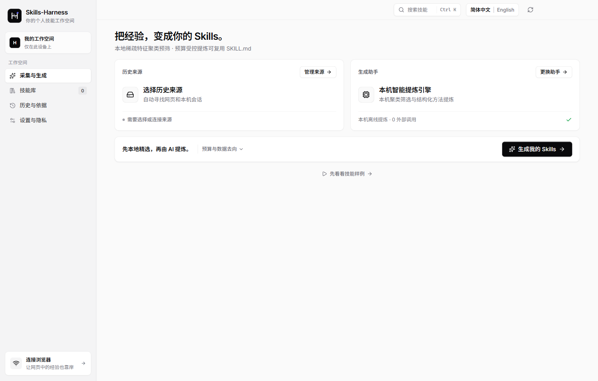

> **欢迎大家再我的基础上进行二次修改改进，欢迎批评指正。**  
> **Welcome to modify, improve, and build upon this work — critiques, issues, and pull requests are warmly welcomed!**

# Skills-Harness (`skills-harness`) — English Guide

**Automatically distill chat histories across AI web pages, apps, software, and local coding agent tools (including GPT, Claude, Gemini, Codex, Claude Code, Cursor, DeepSeek Harness, OpenClaw, Hermes, etc.) into Skills (`SKILL.md`).**

[中文主文档 (Chinese & Bilingual README)](README.md) · [Installation](docs/INSTALL.md) · [Compatibility](docs/COMPATIBILITY.md) · [Privacy](docs/PRIVACY.md)



## Overview

**Skills-Harness** is a local-first desktop application that discovers your saved conversations across web AI assistants and local coding harnesses, filters out noise locally using **Contrastive Trajectory Submodular Selection (`CTSS`)**, and distills repeatable procedures, user preferences, and corrections into standard `SKILL.md` packages.

- **22 Supported History Sources**:
  - **Local Agent Harnesses**: Codex (`~/.codex`), Claude Code (`~/.claude`), Google Antigravity (`~/.gemini/antigravity`), Gemini CLI (`~/.gemini`), OpenClaw (`~/.openclaw`), Hermes Agent (`~/.hermes`), DeepSeek Harness (`~/.deepseek`), Cursor, and OpenCode.
  - **Web Assistants & File Imports**: ChatGPT, Claude, Gemini, DeepSeek, Grok, Perplexity, Doubao, Qwen, Kimi, Tencent Yuanbao, Microsoft Copilot, GitHub Copilot, and Meta AI.
- **Reuse Signed-In Generation Tools (No Extra API Setup Needed)**:
  - Connects to your signed-in **Codex**, **Claude Code**, **Google Antigravity (`agy`)**, **Gemini CLI**, **OpenClaw**, **Hermes Agent**, **DeepSeek Harness**, or **Cursor** CLI, local **Ollama** models, **OpenAI-compatible APIs**, or the **0-call Local Extraction Engine**.
- **Clean `SKILL.md` Output & One-Click Agent Installation**:
  - Generates clean `SKILL.md` files without clutter and installs them directly into `~/.codex/skills`, `~/.claude/skills`, `~/.gemini/antigravity/skills`, `~/.gemini/skills`, `~/.openclaw/skills`, `~/.hermes/skills`, `~/.deepseek/skills`, or `~/.cursor/skills`.

## Quick Start

```bash
npm install
npm run build
npm start
```

Run tests and typecheck:

```bash
npm run typecheck
npm test
```

## License

Released under the [MIT License](LICENSE). See [README.md](README.md) for the complete bilingual documentation.
