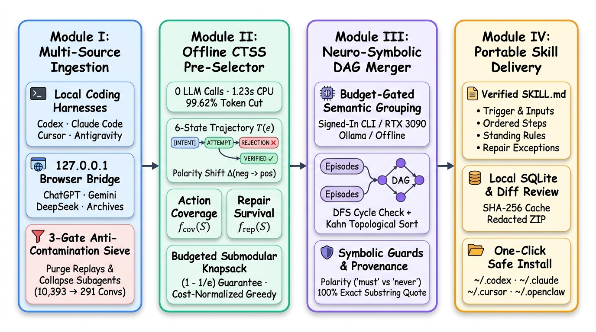
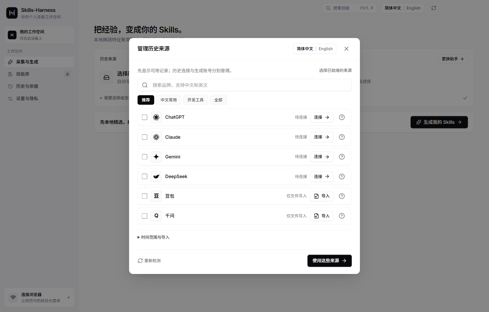
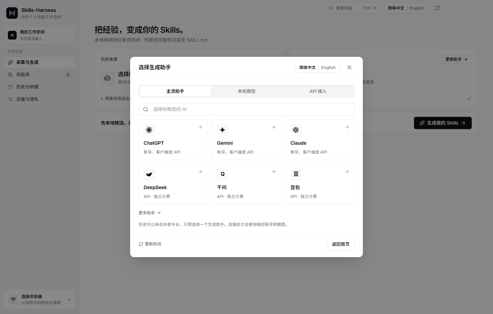
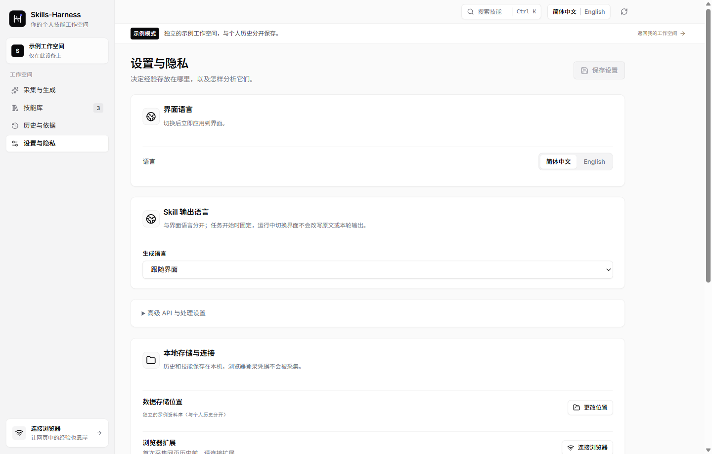

> **欢迎大家在我的基础上进行二次修改改进，欢迎批评指正。**  
> **Welcome to modify, improve, and build upon this work — critiques, issues, and pull requests are warmly welcomed!**

# Skills-Harness (`skills-harness`) — English Guide

**Automatically distill chat histories across AI web pages, apps, software, and local coding agent tools (including GPT, Claude, Gemini, Codex, Claude Code, Cursor, DeepSeek Harness, OpenClaw, Hermes, etc.) into Skills (`SKILL.md`).**

[](https://github.com/WYH302/skills-harness/actions/workflows/ci.yml)
[](https://github.com/WYH302/skills-harness/releases/latest)
[](LICENSE)
[](https://github.com/WYH302/skills-harness/releases/latest)
[](tests/)

[🚀 Direct Download (v0.1.14)](https://github.com/WYH302/skills-harness/releases/latest) · [Chinese & Bilingual README](README.md) · [Installation](docs/INSTALL.md) · [Compatibility](docs/COMPATIBILITY.md) · [Privacy](docs/PRIVACY.md)


### 📥 Direct Downloads

| Version | Asset | Description |
| :--- | :--- | :--- |
| **Windows Installer (Recommended)** | [**`skills-harness-Setup-0.1.14-x64.exe`**](https://github.com/WYH302/skills-harness/releases/download/v0.1.14/skills-harness-Setup-0.1.14-x64.exe) | Bundles runtime, installs without admin rights, adds desktop & start menu shortcuts |
| **Windows Portable** | [**`skills-harness-0.1.14-Windows-x64.exe`**](https://github.com/WYH302/skills-harness/releases/download/v0.1.14/skills-harness-0.1.14-Windows-x64.exe) | Single executable, zero residue, runs directly from anywhere |

## Overview

**Skills-Harness** is a modest, local-first desktop utility that discovers your saved conversations across web AI assistants and local coding harnesses, filters out noise locally using **Contrastive Trajectory Submodular Selection (`CTSS`)**, and organizes repeatable procedures, user preferences, and corrections into standard `SKILL.md` packages. There is still plenty of room for improvement—suggestions, issues, and pull requests are always welcome.

- **22 Supported History Sources**:
  - **Local Agent Harnesses**: Codex (`~/.codex`), Claude Code (`~/.claude`), Google Antigravity (`~/.gemini/antigravity`), Gemini CLI (`~/.gemini`), OpenClaw (`~/.openclaw`), Hermes Agent (`~/.hermes`), DeepSeek Harness (`~/.deepseek`), Cursor, and OpenCode.
  - **Web Assistants & File Imports**: ChatGPT, Claude, Gemini, DeepSeek, Grok, Perplexity, Doubao, Qwen, Kimi, Tencent Yuanbao, Microsoft Copilot, GitHub Copilot, and Meta AI.
- **Reuse Signed-In Generation Tools (No Extra API Setup Needed)**:
  - Connects to your signed-in **Codex**, **Claude Code**, **Google Antigravity (`agy`)**, **Gemini CLI**, **OpenClaw**, **Hermes Agent**, **DeepSeek Harness**, or **Cursor** CLI, local **Ollama** models, **OpenAI-compatible APIs**, or the **0-call Local Extraction Engine**.
- **Clean `SKILL.md` Output & Optional Agent Installation**:
  - Generates clean `SKILL.md` files without clutter and installs them into `~/.codex/skills`, `~/.claude/skills`, `~/.gemini/antigravity/skills`, `~/.gemini/skills`, `~/.openclaw/skills`, `~/.hermes/skills`, `~/.deepseek/skills`, or `~/.cursor/skills`.

## Workflow & Interface Gallery



| Workbench Home | History Sources |
| :---: | :---: |
|  |  |
| **Generation Tools** | **Settings & Privacy** |
|  |  |

## Quick Start

```bash
npm install
npm run build
npm start
```

Run tests and typecheck:

```bash
npm run typecheck
npm test
```

## License

Released under the [MIT License](LICENSE). See [README.md](README.md) for the complete bilingual documentation.
