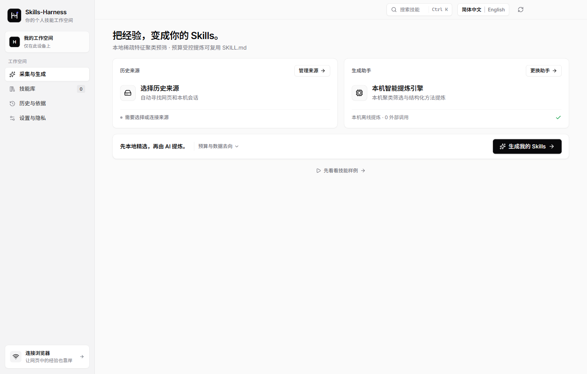
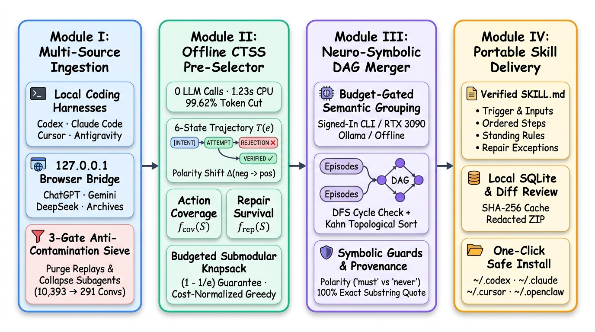
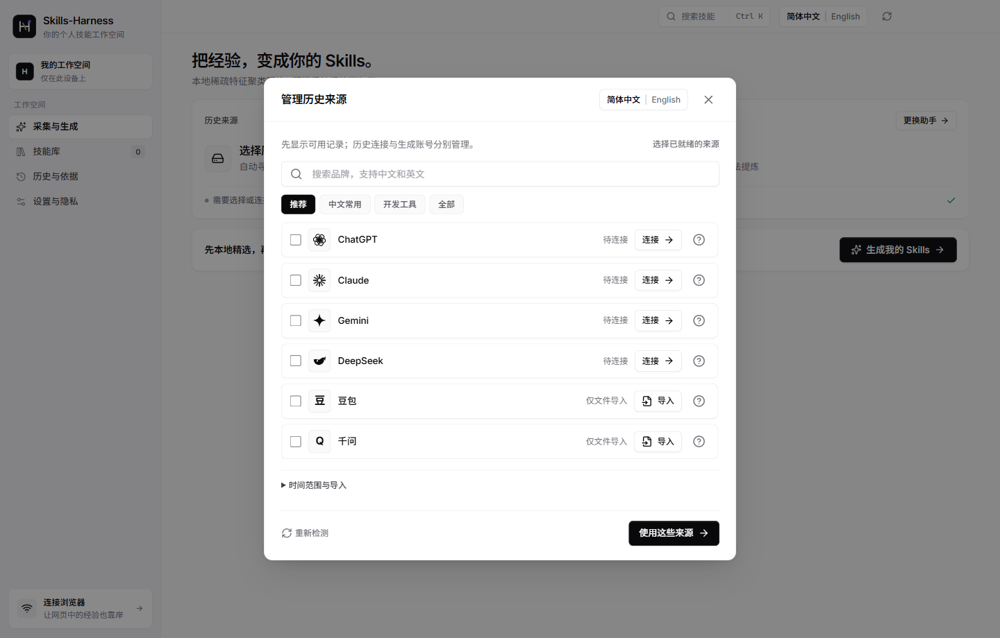
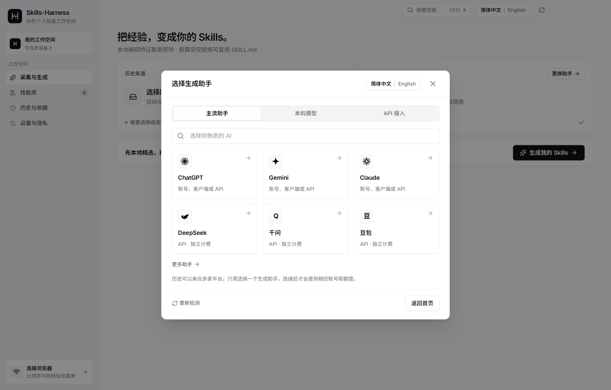
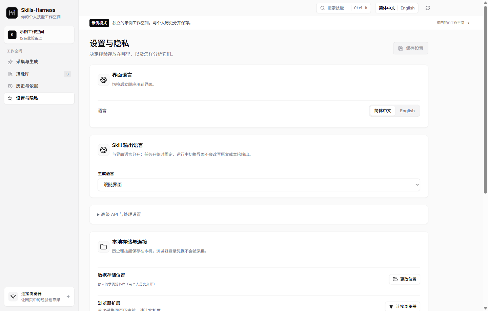

> **欢迎大家在我的基础上进行二次修改改进，欢迎批评指正。**  
> **Welcome to modify, improve, and build upon this work — critiques, issues, and pull requests are warmly welcomed!**

# Skills-Harness (`skills-harness`)

**本地优先（Local-First）的三通道对话日志编译器：将分散在各 AI 网页助手与本地编程 Agent 工具中的杂乱聊天历史（覆盖 22 个平台），自动拆解编译为「本地隐私保险箱（Privacy Vault）」、「开源 Agent 可执行马具规则（ECC/Claude Code & Codex CLI Harness）」与「可溯源技能手册（`SKILL.md`）」。**  
**A local-first, three-channel conversational log compiler that decouples noisy multi-platform AI chat histories (across 22 ecosystems) into an encrypted Local Privacy Vault, executable Open-Source Agent Harness rules (`ECC`/Claude Code `hooks.json` & `Codex CLI` Starlark `.rules`), and verifiable `SKILL.md` playbooks.**

[](https://github.com/WYH302/skills-harness/actions/workflows/ci.yml)
[](https://github.com/WYH302/skills-harness/releases/latest)
[](LICENSE)
[](https://github.com/WYH302/skills-harness/releases/latest)
[](tests/)

[🚀 下载桌面安装包 (Releases)](https://github.com/WYH302/skills-harness/releases/latest) · [中文说明](#-项目简介) · [English Guide](#-english-overview) · [设计思考与踩坑手记](#-设计思考与踩坑手记--design-reflections--lessons-learned) · [架构与界面预览](#️-架构流程与界面预览--architecture--ui-gallery) · [快速开始](#-快速开始--quick-start) · [支持矩阵](#-支持平台矩阵--supported-ecosystem) · [引用格式](#-引用格式--citation)



### 📥 一键下载体验 / Direct Downloads

| 版本 / Version | 文件名 / Asset | 说明 / Description |
| :--- | :--- | :--- |
| **Windows 一键安装版 (推荐)** | [**`skills-harness-Setup-0.1.14-x64.exe`**](https://github.com/WYH302/skills-harness/releases/download/v0.1.14/skills-harness-Setup-0.1.14-x64.exe) | 自带完整运行环境，无需管理员提权，自动生成桌面图标 |
| **Windows 便携免安装版** | [**`skills-harness-0.1.14-Windows-x64.exe`**](https://github.com/WYH302/skills-harness/releases/download/v0.1.14/skills-harness-0.1.14-Windows-x64.exe) | 单文件双击即开，零系统残留，适合移动便携使用 |

---

## 📌 项目简介

在日常开发与科研中，我们在网页端 AI 助手（ChatGPT、Claude、Gemini、DeepSeek、千问、豆包等）与本地编程 Agent（Codex CLI、Claude Code、Google Antigravity `agy`、Gemini CLI、Cursor、OpenCode 等）之间频繁切换，很快就会在硬盘里沉淀下数千万 Token 的杂乱对话记录。

**Skills-Harness** 是一个 **本地优先（Local-First）** 的开源桌面工作台与编译工具链（项目仍在持续打磨，难免有疏漏与不完善之处，非常欢迎大家提 Issue、提 PR 或直接二次修改）。它不再把原始聊天记录一股脑塞给大模型做“摘要”，而是先在本地 CPU 上按三条边界拆解编译：

1. **通道 1 · 本地隐私保险箱（Local Privacy Vault, `src/core/privacy-vault.ts`）**：在进入预筛或任何模型调用前，识别 10 类中英双语个人隐私与工程密钥（API Key、PEM 私钥、数据库连接串、JWT、邮箱、手机号、校验位验证的身份证/SSN、Luhn 校验银行卡、家庭住址及个人敏感披露），内置代码防误伤守卫（豁免 Git Commit Hash、UUID、SemVer 版本号与示例域名），通过 **AES-256-GCM + PBKDF2-SHA256** 加密封存至本地可审计台账，仅向下游暴露类型化占位符 `[VAULT:CATEGORY_NN]`。
2. **本机零调用预筛（Pure Monotone CELF CTSS, `src/core/selection.ts`）**：在纯 CPU、0 VRAM 下，通过带执行收敛识别（`Tool Error -> Patch -> Pass`）与非对称凹凸饱和的纯单调子模背包算法，在 95%–99.6% 压缩率下保留高频操作步骤与稀疏人工纠正，将下游提炼 Token 开销降低 **97% 以上**。
3. **通道 2 · 开源 Agent 马具规则编译（Open-Source Harness Compiler, `src/core/harness-compiler.ts`）**：从历史禁令、工具链替换（如 `pnpm` 替代 `npm`、`uv` 替代 `pip`）、前置检查与重复验证命令中，直接编译生成符合规范的 **`ECC`/Claude Code `hooks.json`**（含独立 Node.js `exit code 2` 阻断脚本）与 **OpenAI `Codex CLI` Starlark `.rules`**，让硬禁令在模型权重之外确定性执行。
4. **通道 3 · 可溯源技能手册编译（Guarded Anchor-DAG `SKILL.md`, `src/core/skills.ts` + `anchor-matcher.ts`）**：通过「字面/参数/极性硬门控 + 轻量 CPU ONNX 语义对齐」、Kahn 拓扑排序、盲元数据仓库作用域隔离、投毒防火墙与过期规则收敛，生成 100% 附带原文摘录溯源的纯净 `SKILL.md`，并支持一键安装至本地各 Agent 的 `skills` 目录。

---

## 🌐 English Overview

> **Welcome to modify, improve, and build upon this work — critiques, issues, and pull requests are warmly welcomed!**

**Skills-Harness** is a humble, **local-first desktop workbench and three-channel log compiler** (built with Electron, React, TypeScript, and Node SQLite) that turns noisy multi-platform AI chat histories across **22 ecosystems** into three separated, auditable outputs. It is an actively evolving open-source effort with plenty of room for improvement—critical feedback, bug reports, and forks are always appreciated.

- **Channel 1 — Local Privacy Vault (`src/core/privacy-vault.ts`)**: Scans bilingual transcripts locally for 10 PII and credential classes (API keys, PEM blocks, database URIs, JWTs, emails, phone numbers, checksum-validated national IDs/SSNs, Luhn-validated bank cards, home addresses, and personal disclosures) with benign-code lookalike exemptions (git hashes, UUIDs, SemVer, Unix timestamps). Encrypts findings locally via **AES-256-GCM** and replaces raw spans with typed placeholders `[VAULT:CATEGORY_NN]` before any screening or LLM call.
- **Zero-Inference CPU Screening (`Pure Monotone CELF CTSS`, `src/core/selection.ts`)**: Screens multi-million-token archives strictly on CPU (`0 MiB VRAM`, millisecond latency) using asymmetric action coverage ($\sqrt{z}$) and repair survival ($\log(1+z)$) over six-state trajectories, cutting downstream distillation tokens by **97.0%–97.8%**.
- **Channel 2 — Open-Source Agent Harness Compiler (`src/core/harness-compiler.ts`)**: Automatically compiles repository-scoped prohibitions, tool substitutions, prerequisite checks, recurring post-edit verifiers, and `PostOutput` invariants into schema-valid **`ECC`/Claude Code `hooks.json`** (exit-code-2 guard runner) and **OpenAI `Codex CLI` Starlark `.rules`**.
- **Channel 3 — Verifiable `SKILL.md` Playbooks (`src/core/skills.ts` & `anchor-matcher.ts`)**: Uses a Hybrid Anchor Gate (symbolic literal/polarity pre-gate + quantized CPU ONNX encoder), Kahn topological sorting, blind-metadata repository-scope isolation, poisoned-skill firewall, and staleness reconciliation to emit clean `SKILL.md` playbooks with **100% verbatim source quotes**, keeping optional LLM calls strictly to titles and triggers (reusing signed-in CLIs, local Ollama, OpenAI-compatible APIs, or a 0-call local engine).

---

## 💡 设计思考与踩坑手记 / Design Reflections & Lessons Learned

做这个项目并不是一开始就想好了“三通道编译器”，而是在真实处理自己几千万字符的编程聊天记录时，一步步踩坑、推翻重来摸索出来的几个教训（也很希望能和社区一起讨论更优雅的解法）：

1. **踩坑一：把聊天记录当“长文档摘要”直接喂给大模型，边界立刻全线崩塌**  
   最初我们也试过最直观的做法——把筛选后的聊天记录交给大模型总结 `SKILL.md`。结果很快发现三个致命隐患：一是平时调试贴进对话框的真实 API Key、邮箱和数据库连接串会原封不动飞向外部模型；二是 95% 以上的寒暄与长报错日志会淹没掉用户只说过一两次的关键纠正；三是某一个仓库的私有禁令（例如 `billing` 仓库禁用 `--force`）会被大模型概括成全局规则，误伤其他仓库。这让我们意识到：聊天记录里混叠着**信息可见性（隐私）**、**硬执行约束（马具）**与**软过程经验（技能）**三条完全正交的边界，必须先拆通道再编译。
2. **踩坑二：迷信纯语义向量（ONNX / GPU Embedding）反而会酿成灾难性误合并**  
   在尝试把中文和英文的跨会话步骤对齐时，我们原本以为直接上多语言语义向量相似度就够了。但实测 400 组含对抗样例的步骤对时大跌眼镜：纯 CPU ONNX 向量把 **199/200 组“标志位、数值阈值或禁止极性完全相反”的命令全合并成了同一条规则**（$F_1$ 仅 66.1%）。加上一层微秒级的符号硬门控（先校验 CLI 标志、数字、路径字面量与极性一致，再放行给量化 CPU ONNX 做跨语种语义对齐）后，误合并直接归零（0/200），$F_1$ 升至 93.9%，CPU 耗时反而快了 4.9 倍。
3. **踩坑三：哪怕 `SKILL.md` 写得 100% 干净准确，大模型在运行时依然会“看到了但不照做”**  
   在给不同规模的模型（0.5B–9B 本地权重与前沿推理模型）做逐条归因审计时，我们发现一个此前低估的现象：即使 `SKILL.md` 已经做到 0 遗漏、0 矛盾污染，前沿模型在长上下文里仍然会无视 5.5%–12.0% 的明确指令（`Delivered-Not-Followed`）。这也坚定了我们把硬约束直接编译进现有开源生态 **`ECC`/Claude Code `hooks.json`（exit code 2 兜底）** 和 **`Codex CLI` Starlark `.rules`** 的方向——软经验进 Prompt，硬红线交给确定性代码守门。
4. **目前仍很朴素、欢迎大家一起改进的地方**：  
   - 低于 1B 的极小模型（如 `0.5B`）很难根据 `stderr` 报错稳定输出合规的结构化修复，目前闭环修复收益主要从 `4B+` 模型开始显现；
   - 不带任何命令失败或显式否定词的“纯反讽/隐晦吐槽”，零推理状态机还抓不住；
   - 不同构建工具链之间的等价命令（如 `npm test` vs `pnpm run test`）未来很值得引入轻量 AST 级命令等价匹配。

*In short (English summary): three hard lessons shaped this codebase—(1) flat LLM summarization conflates privacy, hard execution guards, and soft skills; (2) pure neural embeddings collapsed 199/200 opposite-flag or opposite-polarity steps until gated by microsecond symbolic literal checks; and (3) even clean `SKILL.md` prose suffers 5.5%–12.0% runtime noncompliance ("delivered-not-followed"), which deterministic exit-code-2 `ECC`/`Codex` hooks close cleanly at 0.027 ms CPU overhead. Sub-1B repair capacity, implicit sarcasm without tool traces, and cross-toolchain AST command equivalence remain open challenges where contributions are warmly welcome.*

---

## 🖼️ 架构流程与界面预览 / Architecture & UI Gallery

### 1. 三通道编译架构 / Three-Channel Compiler Architecture



> **流程简述 / Pipeline Summary**：**(1) 三重防污染筛与通道 1 本地隐私保险箱 ($\mathcal{P}$)**（AES-256-GCM 隔离 10 类隐私与密钥，替换为 `[VAULT:ID]`） $\rightarrow$ **(2) 本机纯 CPU 单调 CELF CTSS 预筛**（0 LLM 调用、0 VRAM，95%–99.6% 压缩下保住稀疏纠正） $\rightarrow$ **(3) 双路符号边界编译**：通道 2 输出 **`ECC`/Claude Code `hooks.json` 与 `Codex CLI` `.rules` ($\mathcal{H}$)**，通道 3 经 Hybrid Anchor Gate + Kahn DAG + 防火墙输出 100% 原文溯源的 **`SKILL.md` ($\mathcal{K}$)**。

### 2. 桌面端界面一览 / Desktop Interface Gallery

| 工作台首页 / Workbench Home | 历史来源管理 / History Sources |
| :---: | :---: |
|  |  |
| 本地预筛与生成入口，支持中英双语实时切换<br>*Clean local-first workbench with instant ZH/EN toggle* | 独立管理本机 Agent 会话、浏览器连接与导出文件<br>*Manage local session stores, browser bridge, and file imports* |
| **生成助手选择 / Generation Tools** | **设置与隐私保护 / Settings & Privacy** |
|  |  |
| 沿用已登录 CLI 账号、本机 Ollama、兼容 API 或离线提炼<br>*Reuse signed-in CLIs, local Ollama, APIs, or 0-call local engine* | 数据仅保存在本机 SQLite，支持示例工作空间隔离体验<br>*100% local SQLite storage with isolated demo workspace* |

---

## 🧩 支持平台矩阵 / Supported Ecosystem

### 1. 历史来源 / History Sources (22 Platforms)

| 类别 / Category | 平台 / Platform | 采集方式 / Collection Mode | 默认扫描路径或说明 / Store & Notes |
| :--- | :--- | :--- | :--- |
| **本地 Agent 工具**<br>*(Local Agent Harnesses)* | **Codex** (`codex`) | 自动发现 & 增量读取 | `~/.codex/sessions`, `~/.codex/archived_sessions` (`.jsonl` / `.gz` / `.zst`) |
| | **Claude Code** (`claude-code`) | 自动发现 & 增量读取 | `~/.claude/projects` (JSONL 会话与工具调用记录) |
| | **谷歌反重力 · Google Antigravity** (`antigravity`) | 自动发现 & 增量读取 | `~/.gemini/antigravity/brain/*/.system_generated/logs/transcript.jsonl` |
| | **Gemini CLI** (`gemini-cli`) | 自动发现 & 增量读取 | `~/.gemini/tmp`, `~/.gemini/sessions`, `~/.gemini/chats` |
| | **OpenClaw** (`openclaw`) | 自动发现 & 增量读取 | `~/.openclaw/sessions`, `~/.openclaw/agents`, `~/.openclaw/logs` |
| | **Hermes Agent** (`hermes`) | 自动发现 & 增量读取 | `~/.hermes/sessions`, `~/.hermes/trajectories`, `~/.hermes/logs` |
| | **DeepSeek Harness** (`deepseek-harness`) | 自动发现 & 增量读取 | `~/.deepseek/sessions`, `~/.deepseek-harness/sessions` |
| | **Cursor** (`cursor`) | 自动发现 (只读 SQLite) | `Cursor/User/globalStorage` & `workspaceStorage` (`state.vscdb`) |
| | **OpenCode** (`opencode`) | 自动发现 (SQLite / JSON) | `~/.local/share/opencode` |
| **网页端 AI 助手**<br>*(Web AI Assistants)* | **ChatGPT**, **Claude**, **Gemini**, **DeepSeek**, **Grok**, **Perplexity** | 浏览器扩展配对采集 / 导出文件导入 | 通过本机回环桥接（Loopback Bridge）配对扩展，或直接导入官方导出包 |
| **通用文件导入支持**<br>*(File Import Supported)* | **豆包 (Doubao)**, **千问 (Qwen)**, **Kimi**, **腾讯元宝 (Yuanbao)**, **Microsoft Copilot**, **GitHub Copilot**, **Meta AI** | 文件导入 (`JSON` / `JSONL` / `ZIP` / `Markdown` / `HTML` / `XML` / `TXT`) | 支持结构化导出文件或带角色标签的对话记录导入 |

### 2. 已连接的生成工具与马具目标 / Connected Tools & Harness Targets

- **已登录 CLI / 会员通道复用（免填 API Key）**：`Codex`、`Claude Code`、`Google Antigravity (agy)`、`Gemini CLI`、`OpenClaw`、`Hermes Agent`、`DeepSeek Harness`、`Cursor`
- **本机离线与本地大模型**：纯 CPU `extractive` 零调用引擎、本机 `Ollama` (`127.0.0.1:11434`)、自定义 OpenAI 兼容 API（带硬预算上限）
- **可执行马具规则目标（Channel 2）**：`ECC` / Claude Code `hooks.json`（`PreToolUse` / `PostToolUse` / `permissions.deny` + exit-2 runner）、OpenAI `Codex CLI` Starlark `execpolicy` (`.rules`)
- **技能安装目录（Channel 3）**：一键写入 `~/.codex/skills`、`~/.claude/skills`、`~/.gemini/antigravity/skills`、`~/.gemini/skills`、`~/.openclaw/skills`、`~/.hermes/skills`、`~/.deepseek/skills`、`~/.cursor/skills`（绝不覆盖已有同名目录）

---

## 🔒 隐私与安全架构 / Privacy & Security

1. **100% 本地优先与零遥测**：所有导入对话、加密隐私保险箱、马具规则与技能版本均保存在本机，无云端同步与遥测上报。
2. **AES-256-GCM 本地隐私保险箱 (`src/core/privacy-vault.ts`)**：预筛与外部调用前自动隔离 10 类中英双语敏感实体与工程凭据，豁免常见合法代码字面量（Git Hash、UUID、SemVer 等）。
3. **只读采集与生成沙箱隔离**：只读扫描本地历史并排除自身会话；调用外部 CLI 分析时强制只读沙箱，绝不执行聊天记录中出现的命令。
4. **投毒技能防火墙与候选人工确认**：内置 5 类提示词注入/外泄/隐藏 HTML 拦截守卫；新技能与马具规则默认需人工审阅后方才安装生效。

---

## 🚀 快速开始 / Quick Start

### 环境要求 / Prerequisites
- **Node.js**: `>= 22.5.0`（推荐 **Node.js 24 LTS**，内置 `node:sqlite`）
- **Python（可选，用于统计分析与论文图表复现）**: Python `>= 3.10`，依赖见 [`requirements.txt`](requirements.txt)（`pip install -r requirements.txt`）
- **OS**: Windows 10/11 (x64)、macOS 或 Linux

```bash
# 1. 安装依赖 / Install dependencies
npm install

# 2. 类型检查与全套单元/集成测试 (151/151) / Typecheck & full tests
npm run typecheck
npm test

# 3. 构建并启动本地桌面工作台 / Build & start desktop workbench
npm run build
npm start

# 4. 可选：安装 Python 评测与绘图依赖 / Optional Python reproducibility deps
pip install -r requirements.txt

# 5. 打包桌面安装包 / Package Windows installer & portable binary
npm run package
```

---

## 📂 项目目录结构 / Project Structure

```text
skills-harness/
├── src/
│   ├── adapters/              # 22 平台本地日志/SQLite 只读发现与多格式解析器
│   ├── core/
│   │   ├── privacy-vault.ts   # Channel 1: 10 类双语隐私/密钥提取与 AES-256-GCM 本地保险箱
│   │   ├── selection.ts       # Pure Monotone CELF CTSS 纯 CPU 子模轨迹预筛
│   │   ├── harness-compiler.ts# Channel 2: ECC/Claude Code hooks.json & Codex Starlark 规则编译器
│   │   ├── anchor-matcher.ts  # Channel 3: 字面/极性硬门控 + 轻量化 CPU ONNX 锚点对齐
│   │   ├── skills.ts          # Channel 3: Guarded Anchor-DAG SKILL.md 合成、防火墙与过期收敛
│   │   ├── personal-filters.ts# 三重防污染筛与个人代码/噪音过滤器
│   │   └── mining.ts          # 六状态轨迹识别与执行收敛 (Error -> Fix -> Pass) 挖掘
│   ├── main/                  # Electron 主进程、IPC 安全边界与系统级凭据加密
│   ├── renderer/              # React + TypeScript 双语桌面工作台
│   └── shared/                # 跨进程类型、平台注册表与中英双语字典
├── extension/                 # Manifest V3 浏览器配套扩展（网页端 AI 历史配对采集）
├── examples/                  # 100% 人工合成公开测试样例（不含任何个人隐私数据）
├── tests/                     # 151 项自动化测试（含三通道编译器、隐私隔离与马具规则单测）
├── docs/                      # 详细文档与架构/界面截图
├── requirements.txt           # Python 评测与图表复现依赖清单
└── scripts/                   # 构建、开发与打包脚本
```

---

## 📚 引用格式 / Citation

如果本项目的开源代码、三通道编译思路或评测基准对你的研究与工程实践有所帮助，欢迎引用（项目仍在持续打磨，随时欢迎提 Issue 与 PR 批评指正）：

```bibtex
@article{wu2026skillsharness,
  author  = {Wu, Yonghao},
  title   = {Skills-Harness: Compiling Noisy Multi-Platform Conversational Logs into Privacy Vaults, Executable Agent Harnesses, and Verifiable Skills},
  year    = {2026},
  url     = {https://github.com/WYH302/skills-harness},
  note    = {Open-source MIT software and benchmark artifacts}
}
```

---

## 📄 开源许可与致谢 / License & Attributions

- 本项目源码采用 **[MIT License](LICENSE)** 开源。
- 第三方开源组件说明与致谢详见 [OPEN_SOURCE_ATTRIBUTIONS.md](OPEN_SOURCE_ATTRIBUTIONS.md)。
- **再次欢迎大家在我的基础上进行二次修改改进，欢迎提交 Issue 与 PR 批评指正！**
