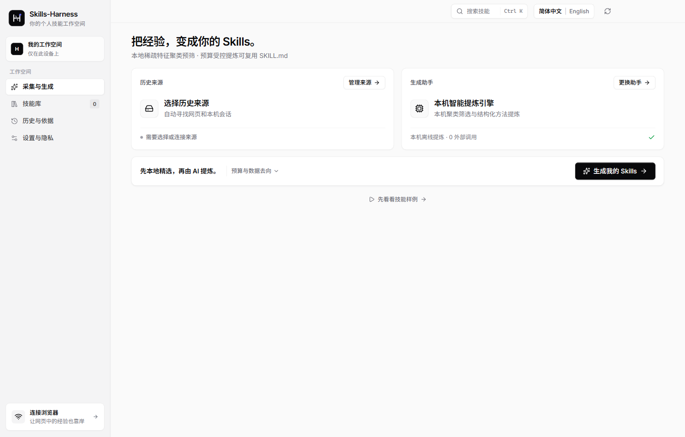

> **欢迎大家再我的基础上进行二次修改改进，欢迎批评指正。**  
> **Welcome to modify, improve, and build upon this work — critiques, issues, and pull requests are warmly welcomed!**

# Skills-Harness (`skills-harness`)

**将分散在各大 AI 助手与本地编程工具中的聊天历史，自动提炼为结构化、可复用的个人 Agent Skills（`SKILL.md`）。**  
**Turn scattered AI chat histories and coding agent trajectories into structured, reusable Agent Skills (`SKILL.md`).**

[中文说明](#-项目简介) · [English Guide](#-english-overview) · [安装与运行](#-快速开始--quick-start) · [支持矩阵](#-支持平台矩阵--supported-ecosystem) · [隐私与安全](#-隐私与安全架构--privacy--security)



---

## 📌 项目简介

在日常开发与研究工作中，我们与各种 AI 网页助手（ChatGPT、Claude、Gemini、DeepSeek、千问、豆包等）以及本地 Agent 工具（Codex、Claude Code、Google Antigravity `agy`、Gemini CLI、OpenClaw、Hermes Agent、DeepSeek Harness、Cursor、OpenCode 等）产生了数以千计的多轮对话。其中蕴含着大量经过反复调试才跑通的 **标准操作流程（SOP）**、**个人格式规范** 与 **避坑纠正经验**，但它们往往被淹没在冗长的历史记录里。

**Skills-Harness** 是一个 **本地优先（Local-First）** 的桌面端工程化工具：
1. **自动发现本机与网页历史**：自动识别本机已安装的 Agent 会话存储（含 Windows 原生目录与 WSL 环境），并通过配套浏览器扩展或导出文件接入网页端对话历史。
2. **本地预筛与聚类（CTSS 算法）**：在调用任何大模型之前，先在本机通过 **对比轨迹子模选择（Contrastive Trajectory Submodular Selection, CTSS）** 与稀疏 TF-IDF 特征聚类，剔除单次闲聊、重复日志与废弃分支，将原始历史压缩 **95%+**，仅保留高价值的程序性片段与用户纠正。
3. **免配 API 沿用已登录生成工具**：历史来源与生成工具分别独立检测。可直接复用本机已登录的 **ChatGPT (Codex)**、**Claude Code**、**谷歌反重力 (Google Antigravity / `agy`)**、**Gemini CLI**、**OpenClaw**、**Hermes Agent**、**DeepSeek Harness**、**Cursor** 账户配额，或连接本机 **Ollama** 及任意 **OpenAI 兼容 API**，也可使用 **0 外部调用的本机离线提炼引擎**。
4. **纯净标准 `SKILL.md` 产出与一键安装**：生成符合 Agent Skills 规范的纯净 `SKILL.md`（包含触发条件、输入、执行步骤、个人要求、输出及例外纠正），支持版本对比、回滚、ZIP 导出，或一键安装至各大本地 Agent 的 `skills` 目录。

---

## 🌐 English Overview

> **Welcome to modify, improve, and build upon this work — critiques, issues, and pull requests are warmly welcomed!**

**Skills-Harness** is a **local-first desktop engineering harness** (built with Electron, React, TypeScript, and Node SQLite) that distills massive, scattered AI chat logs and coding agent trajectories into clean, reusable **Agent Skills (`SKILL.md`)**.

### Key Highlights
- **Multi-Source History Collection**: Automatically discovers local session stores from **Codex**, **Claude Code**, **Google Antigravity (`agy`)**, **Gemini CLI**, **OpenClaw**, **Hermes Agent**, **DeepSeek Harness**, **Cursor**, and **OpenCode** (across native OS paths and WSL), plus web histories (**ChatGPT**, **Claude**, **Gemini**, **DeepSeek**, **Grok**, **Perplexity**) via a paired Manifest V3 browser extension or file imports (**Doubao**, **Qwen**, **Kimi**, **Yuanbao**, **Copilot**, **Meta AI**).
- **Local Pre-Screening & Compression (`CTSS`)**: Runs **Contrastive Trajectory Submodular Selection (`CTSS`)** and sparse lexical clustering 100% locally before any LLM call—filtering out status noise, subagent loops, and one-off chats while compressing raw token volume by **95%+**.
- **Bring Your Own Signed-In Harness (Zero Extra API Setup)**: History sources and generation tools are detected independently. Reuse your existing signed-in **Codex**, **Claude Code**, **Google Antigravity (`agy`)**, **Gemini CLI**, **OpenClaw**, **Hermes Agent**, **DeepSeek Harness**, or **Cursor** CLI account, connect a local **Ollama** model, configure an **OpenAI-compatible API**, or run the **0-call Local Extraction Engine**.
- **Clean `SKILL.md` Synthesis & One-Click Delivery**: Produces concise, standard `SKILL.md` files (`When to use`, `Inputs`, `Procedure`, `Preferences`, `Expected output`, `Exceptions and corrections`) with version history, diff review, portable `.zip` export, and one-click installation into detected agent skill directories.

---

## 🧩 支持平台矩阵 / Supported Ecosystem

### 1. 历史来源 / History Sources (22 Platforms)

| 类别 / Category | 平台 / Platform | 采集方式 / Collection Mode | 默认扫描路径或说明 / Store & Notes |
| :--- | :--- | :--- | :--- |
| **本地 Agent 工具**<br>*(Local Agent Harnesses)* | **Codex** (`codex`) | 自动发现 & 增量读取 | `~/.codex/sessions`, `~/.codex/archived_sessions` (`.jsonl` / `.gz` / `.zst`) |
| | **Claude Code** (`claude-code`) | 自动发现 & 增量读取 | `~/.claude/projects` (JSONL 会话与工具调用记录) |
| | **谷歌反重力 · Google Antigravity** (`antigravity`) | 自动发现 & 增量读取 | `~/.gemini/antigravity/brain/*/.system_generated/logs/transcript.jsonl` |
| | **Gemini CLI** (`gemini-cli`) | 自动发现 & 增量读取 | `~/.gemini/tmp`, `~/.gemini/sessions`, `~/.gemini/chats` |
| | **OpenClaw** (`openclaw`) | 自动发现 & 增量读取 | `~/.openclaw/sessions`, `~/.openclaw/agents`, `~/.openclaw/logs` |
| | **Hermes Agent** (`hermes`) | 自动发现 & 增量读取 | `~/.hermes/sessions`, `~/.hermes/trajectories`, `~/.hermes/logs` |
| | **DeepSeek Harness** (`deepseek-harness`) | 自动发现 & 增量读取 | `~/.deepseek/sessions`, `~/.deepseek-harness/sessions` |
| | **Cursor** (`cursor`) | 自动发现 (只读 SQLite) | `Cursor/User/globalStorage` & `workspaceStorage` (`state.vscdb`) |
| | **OpenCode** (`opencode`) | 自动发现 (SQLite / JSON) | `~/.local/share/opencode` |
| **网页端 AI 助手**<br>*(Web AI Assistants)* | **ChatGPT**, **Claude**, **Gemini**, **DeepSeek**, **Grok**, **Perplexity** | 浏览器扩展配对采集 / 导出文件导入 | 通过本机回环桥接（Loopback Bridge）配对扩展，或直接导入官方导出包 |
| **通用文件导入支持**<br>*(File Import Supported)* | **豆包 (Doubao)**, **千问 (Qwen)**, **Kimi**, **腾讯元宝 (Yuanbao)**, **Microsoft Copilot**, **GitHub Copilot**, **Meta AI** | 文件导入 (`JSON` / `JSONL` / `ZIP` / `Markdown` / `HTML` / `XML` / `TXT`) | 支持结构化导出文件或带角色标签的对话记录导入 |

### 2. 已连接的生成工具 / Connected Generation Tools

- **已登录 CLI / 会员通道复用（免填 API Key）**：
  - `ChatGPT · Codex` (`codex`)
  - `Claude · Claude Code` (`claude`)
  - `谷歌反重力 · Google Antigravity` (`agy` / `antigravity`)
  - `Gemini · Gemini CLI` (`gemini`)
  - `OpenClaw` (`openclaw`)
  - `Hermes Agent` (`hermes`)
  - `DeepSeek Harness` (`deepseek-harness` / `deepseek`)
  - `Cursor` (`agent` / `cursor-agent`)
- **本机离线与本地大模型**：
  - **本机智能提炼引擎 (`extractive`)**：纯本机 CPU 聚类与高频步骤合并，**0 外部调用、0 费用**。
  - **Ollama 本机模型 (`ollama`)**：自动探测 `127.0.0.1:11434` 并校验模型权重是否为纯本地运行。
- **OpenAI 兼容 API 接入**：
  - 内置 OpenAI、Google AI Studio (Gemini)、DeepSeek、阿里云百炼 (Qwen 北京/新加坡)、火山方舟 (Doubao)、Moonshot (Kimi)、xAI (Grok)、Perplexity 等预设，支持自定义 Endpoint 与硬性调用预算上限。

### 3. 技能安装目标目录 / Skill Installation Destinations

一键将确认后的技能写入对应助手的本地 `skills` 目录（绝不覆盖已有同名目录）：
- **Codex**: `~/.codex/skills/<skill-name>/SKILL.md`
- **Claude Code**: `~/.claude/skills/<skill-name>/SKILL.md`
- **Google Antigravity (谷歌反重力)**: `~/.gemini/antigravity/skills/<skill-name>/SKILL.md`
- **Gemini CLI**: `~/.gemini/skills/<skill-name>/SKILL.md`
- **OpenClaw**: `~/.openclaw/skills/<skill-name>/SKILL.md`
- **Hermes Agent**: `~/.hermes/skills/<skill-name>/SKILL.md`
- **DeepSeek Harness**: `~/.deepseek/skills/<skill-name>/SKILL.md`
- **Cursor**: `~/.cursor/skills/<skill-name>/SKILL.md`

---

## 🔒 隐私与安全架构 / Privacy & Security

1. **100% 本地数据库存储**：所有导入的原始对话、提取片段与技能版本均保存在本机 SQLite 数据库中，无任何云端同步或遥测上报（Telemetry）。
2. **只读采集与自身会话隔离**：本地适配器以只读方式读取历史日志或 SQLite 快照，并自动排除 `skills-harness` 自身生成或测试时产生的会话，防止循环污染。
3. **生成工具沙箱隔离**：当调用本地 CLI（如 Codex、Claude Code、Gemini CLI 等）分析历史片段时，在独立临时目录中禁用工具执行（`--sandbox read-only` / 禁用 Shell、MCP、Hooks 与文件写入），确保历史文本仅作为不可信数据被分析，绝不执行历史记录中出现的命令。
4. **敏感信息自动脱敏与系统级凭据加密**：分析与导出前自动脱敏常见 API Key（`sk-...`、`ghp_...`、`Bearer ...`）、邮箱与本机隐私路径；API Key 与账号授权令牌使用操作系统原生 `safeStorage` 加密存储。
5. **候选技能默认隔离**：新提炼的技能默认处于 `待确认 (candidate)` 且未启用状态，需由用户审阅并手动点击「安装到助手」后才会写入目标 Agent 的 `skills` 目录。

---

## 🚀 快速开始 / Quick Start

### 环境要求 / Prerequisites
- **Node.js**: `>= 22.5.0`（推荐使用 **Node.js 24 LTS**，内置 `node:sqlite` 支持）
- **OS**: Windows 10/11 (x64)、macOS 或 Linux

### 1. 安装依赖 / Install Dependencies

```bash
npm install
```

### 2. 开发模式运行 / Run in Development Mode

```bash
npm run dev
```

### 3. 构建与启动桌面端 / Build & Start Desktop App

```bash
npm run build
npm start
```

### 4. 运行测试与类型检查 / Typecheck & Tests

```bash
# TypeScript 类型检查 / Type checking
npm run typecheck

# 运行单元与集成测试套件 (145+ 测试用例) / Unit & integration tests
npm test

# 运行 Playwright Electron 端到端界面测试 / E2E UI tests
npm run test:ui
```

### 5. 打包桌面客户端 / Package Desktop Executables

```bash
# 打包免安装目录版 / Unpacked directory build
npm run package:dir

# 打包 Windows NSIS 安装包与便携版 / Windows NSIS installer & portable build
npm run package
```

---

## 📂 项目目录结构 / Project Structure

```text
skills-harness/
├── src/
│   ├── adapters/        # 本地日志/SQLite 自动发现与多平台历史解析器 (Codex, Claude, Antigravity, OpenClaw, Hermes, Cursor...)
│   ├── core/            # 核心流水线：CTSS 预筛聚类、经验提取、大模型预算控制、SKILL.md 生成与安装交付
│   ├── main/            # Electron 主进程、IPC 安全边界校验、OS 凭据加密与生命周期管理
│   ├── renderer/        # React + TypeScript 桌面端界面（中英双语实时切换、工作台、技能库、设置）
│   ├── shared/          # 跨进程类型定义、22 个主流平台目录与双语本地化字典
│   └── vendor/skillopt/ # 移植自 MIT 许可的 SkillOpt-Sleep 轻量级历史清洗与验收标准提取模块
├── extension/           # Manifest V3 浏览器配套扩展（用于网页端 AI 历史配对采集）
├── examples/            # 100% 人工合成的公开测试样例与基准数据（不含任何个人隐私数据）
├── tests/               # 适配器、核心提炼管线、CTSS 选择算法与 Electron E2E 测试套件
└── scripts/             # 构建、开发与打包辅助脚本
```

---

## 📄 开源许可与致谢 / License & Attributions

- 本项目源码采用 **[MIT License](LICENSE)** 开源。
- 第三方开源组件说明与致谢详见 [OPEN_SOURCE_ATTRIBUTIONS.md](OPEN_SOURCE_ATTRIBUTIONS.md)。
- **再次欢迎大家在我的基础上进行二次修改改进，欢迎提交 Issue 与 PR 批评指正！**
